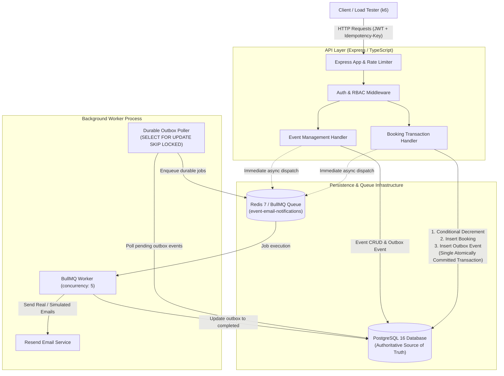
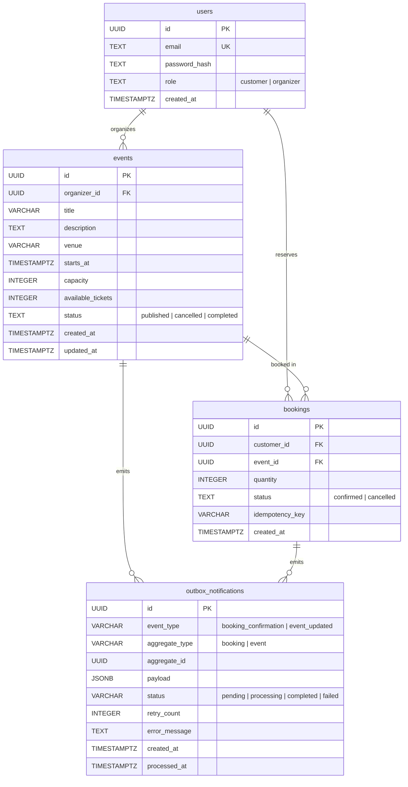

# Event Booking API — Production Backend System

A high-performance, concurrent-safe Event Booking API built with **Node.js, Express, TypeScript, PostgreSQL, and BullMQ on Redis**, featuring transactional inventory reservations, client idempotency, and asynchronous email notification workflows.

---

## 1. Architecture Overview



---

## 2. Key Design Decisions & Technical Rationale

| Decision | Alternative Considered | Technical Rationale & Trade-off |
| :--- | :--- | :--- |
| **PostgreSQL Owns Inventory** | Redis Distributed Locks / In-Memory Counters | Redis counters can desynchronize from persistent database transactions on crashes or rollbacks. By using conditional row-level SQL updates (`WHERE available_tickets >= $1`) inside PostgreSQL transactions, the database enforces strict ACID isolation and prevents overselling even under extreme concurrency. Trade-off: Higher database row contention than pure in-memory counters, mitigated by short transaction windows. |
| **Direct `pg` Driver** | TypeORM / Prisma | Direct SQL via `pg` eliminates ORM abstraction overhead, provides complete control over transaction boundaries (`BEGIN` / `COMMIT`), connection acquisition, and allows fine-grained index tuning. |
| **Client Idempotency Key** | Request Hashing / GUIDs | Clients supply an `Idempotency-Key` header. A PostgreSQL unique constraint on `(customer_id, idempotency_key)` guarantees that network retries never create duplicate bookings or double-decrement inventory. |
| **Transactional Outbox + Queue** | Direct In-Handler Email Sending | Sending emails synchronously inside the HTTP request path introduces 200–1000ms latency and leaves the system vulnerable to network timeouts. Emitting an outbox record inside the transaction guarantees zero lost notifications even if Redis or the email provider is temporarily offline. |
| **User-Keyed Rate Limiting** | Global IP-based rate limiting | Global IP rate limiting starves users sharing corporate NATs, proxies, or load testing runners. Keying quotas by `usr_${userId}` ensures isolated quotas per customer. |

---

## 3. Database Schema & Data Model



### Migration Ledger (`schema_migrations`)
Migrations are managed idempotently through an automated ledger table. When starting up, `src/db/migrate.ts` applies pending `.sql` files in sequence and records completion. Existing tables are detected automatically to prevent `relation already exists` errors.

---

## 4. API Documentation & Sample Requests

### Authentication Endpoints

#### Register Customer (`POST /api/auth/register`)
- **Headers**: `Content-Type: application/json`
- **Request Body**:
  ```json
  {
    "email": "customer@example.com",
    "password": "SecurePassword123!"
  }
  ```
- **Response (201 Created)**:
  ```json
  {
    "user": {
      "id": "c1f7a4d2-...",
      "email": "customer@example.com",
      "role": "customer"
    },
    "accessToken": "eyJhbGciOiJIUzI1NiIsInR5cCI6IkpXVCJ9..."
  }
  ```

#### Register Organizer (`POST /api/auth/organizers/register`)
- **Headers**:
  - `Content-Type: application/json`
  - `x-organizer-invite: <ORGANIZER_INVITE_TOKEN>`
- **Request Body**:
  ```json
  {
    "email": "organizer@example.com",
    "password": "SecurePassword123!"
  }
  ```
- **Response (201 Created)**:
  ```json
  {
    "user": {
      "id": "f8a9b2c3-...",
      "email": "organizer@example.com",
      "role": "organizer"
    },
    "accessToken": "eyJhbGciOiJIUzI1NiIsInR5cCI6IkpXVCJ9..."
  }
  ```

#### Login (`POST /api/auth/login`)
- **Headers**: `Content-Type: application/json`
- **Request Body**:
  ```json
  {
    "email": "customer@example.com",
    "password": "SecurePassword123!"
  }
  ```
- **Response (200 OK)**: Returns `{ user, accessToken }`.

---

### Events Endpoints

#### Browse Events (`GET /api/events`)
- **Query Params**: `page` (default 1), `limit` (default 20, max 100), `search` (optional string).
- **Access**: Public.
- **Response (200 OK)**:
  ```json
  {
    "data": [
      {
        "id": "a1b2c3d4-...",
        "organizer_id": "f8a9b2c3-...",
        "title": "Tech Summit 2026",
        "description": "Annual Technology Conference",
        "venue": "Convention Center",
        "starts_at": "2026-11-15T09:00:00.000Z",
        "capacity": 500,
        "available_tickets": 450,
        "status": "published"
      }
    ],
    "pagination": { "page": 1, "limit": 20, "total": 1 }
  }
  ```

#### Create Event (`POST /api/events`)
- **Access**: Organizers only (`Bearer <token>`).
- **Request Body**:
  ```json
  {
    "title": "Grand Philharmonic Orchestra",
    "venue": "Symphony Hall",
    "startsAt": "2026-12-01T19:30:00.000Z",
    "capacity": 200
  }
  ```
- **Response (201 Created)**: Returns `{ event }` with `available_tickets` initialized to `capacity`.

#### Update Event (`PATCH /api/events/:id`)
- **Access**: Owning organizer only.
- **Behavior**: When `title`, `venue`, or `startsAt` changes, an outbox notification (`event_updated`) is automatically generated and queued for all customers who have confirmed bookings for that event.
- **Response (200 OK)**: Returns updated `{ event }`.

#### Cancel Event (`DELETE /api/events/:id`)
- **Access**: Owning organizer only.
- **Behavior**: Marks `status = 'cancelled'`. Historical bookings are preserved.
- **Response (204 No Content)**.

---

### Bookings Endpoints

#### Book Tickets (`POST /api/events/:id/bookings`)
- **Access**: Customer only.
- **Headers**:
  - `Authorization: Bearer <token>`
  - `Idempotency-Key: <unique-client-key>`
- **Request Body**:
  ```json
  {
    "quantity": 2
  }
  ```
- **Response (201 Created)**:
  ```json
  {
    "booking": {
      "id": "e9b2c1a0-...",
      "customerId": "c1f7a4d2-...",
      "eventId": "a1b2c3d4-...",
      "quantity": 2,
      "status": "confirmed",
      "idempotencyKey": "unique-client-key",
      "createdAt": "2026-10-18T11:00:00.000Z"
    },
    "remainingTickets": 198
  }
  ```
- **Idempotent Retry (200 OK)**: Re-sending the identical request returns the original booking with `"idempotentReplay": true` and zero inventory change.
- **Reused Key with Different Payload (409 Conflict)**:
  ```json
  {
    "error": "IDEMPOTENCY_KEY_REUSED_WITH_DIFFERENT_PAYLOAD"
  }
  ```
- **Sold Out / Insufficient Inventory (409 Conflict)**:
  ```json
  {
    "error": "INSUFFICIENT_INVENTORY",
    "message": "Requested 5 tickets, but only 2 available.",
    "availableTickets": 2
  }
  ```

#### View Customer Bookings (`GET /api/bookings/me`)
- **Access**: Authenticated customer.
- **Response (200 OK)**: Returns list of customer's bookings joined with event title, venue, and date.

#### View Event Bookings (`GET /api/events/:id/bookings`)
- **Access**: Owning organizer only.
- **Response (200 OK)**: Returns list of bookings for the event.

---

## 5. Performance Benchmarks: Baseline vs. Optimized

Load tests were executed using **k6 v0.54.0** scaling up to **100 concurrent virtual users**. Full raw outputs and execution logs are archived in `artifacts/performance/` and documented in [`docs/performance.md`](docs/performance.md).

### Summary Comparison Table

| Metric | Baseline Implementation | Optimized Implementation | Improvement |
| :--- | :--- | :--- | :--- |
| **Concurrent Users (VUs)** | 100 VUs | 100 VUs | Sustained Peak Load |
| **Successful Bookings** | **300** | **9,027** | **+2,909% (30.1x)** |
| **HTTP Failure Rate** | **99.24%** (39,205 failed) | **0.00%** (0 errors) | **100% Reliable** |
| **Sustainable Throughput** | 6.0 bookings/sec | **180.41 bookings/sec** | **30.1x Increase** |
| **p50 Latency (Median)** | 2.37 ms (429 rejections) | **100.01 ms** (full txns) | Predictable Transaction Time |
| **p95 Latency** | 7.76 ms (429 rejections) | **632.41 ms** | Bounded Under 100 VUs |
| **Dropped Iterations** | 0 | **0** | Clean Processing |
| **Unexpected 500 Errors** | 0 | **0** | Zero Server Errors |
| **Contention (50 Tickets / 200 Reqs)** | Blocked by rate limiter | **50 booked, 150 sold-out** | **Strict Zero Overselling** |

### Optimizations Applied
1. **User-Aware Rate Limiting**: Shifted rate-limit keying from IP to customer ID (`usr_${userId}`) with configurable throughput limits.
2. **Connection Pool Tuning**: Increased `DATABASE_POOL_MAX` from 10 to 50 connections, eliminating client acquisition queueing.
3. **JWT Claims Optimization**: Embedded customer email in JWT claims, eliminating the in-transaction user lookup query.
4. **Performance Indexes (Migration 003)**: Added compound index `(id, status, starts_at, available_tickets)` for fast conditional lock updates.

---

## 6. Asynchronous Email Workflows & Background Worker

- **Queue**: BullMQ on Redis.
- **Worker Process**: `src/worker.ts` runs independently from the HTTP API.
- **Transactional Outbox**: All notifications are committed atomically with the booking in PostgreSQL before dispatch.
- **Real Delivery**: Integrated with Resend SDK (`resend.emails.send`).
  - When `RESEND_API_KEY` is present, emails are dispatched to destination inboxes.
  - When running locally without an external Resend key, emails are safely logged and recorded in the outbox ledger with full template simulation.
- **Worker Command**:
  ```bash
  pnpm worker
  ```

---

## 7. Local Setup & Testing

### Prerequisites
- Node.js >= 20 (v22 recommended)
- pnpm >= 9 (v12 installed)
- Docker & Docker Compose

### Step-by-Step Setup
```bash
# 1. Clone repository
cd event-booking-api

# 2. Configure environment
cp .env.example .env

# 3. Start PostgreSQL and Redis
docker compose up -d

# 4. Install dependencies
pnpm install

# 5. Run migrations
pnpm migrate

# 6. Run test suite (32 tests across 7 test files)
pnpm test

# 7. Start API server
pnpm dev
# Or in production mode:
# pnpm build && pnpm start

# 8. Start Background Worker (in another terminal)
pnpm worker
```

### Reproducing Load Tests
```bash
# Prepare benchmark data
npx tsx scripts/load/setup-benchmark-data.ts

# Run throughput test (50 seconds)
k6 run scripts/load/bookings-throughput.js

# Run limited inventory contention test
k6 run scripts/load/bookings-contention.js

# Run event update notification test
k6 run scripts/load/events-updates.js
```

---

## 8. Deployment Guide

### Deploying via Render (Blueprint)
The repository contains `render.yaml` configured for zero-downtime deployment:
1. Connect your repository to [Render](https://render.com).
2. Choose **Blueprints** and select `render.yaml`.
3. Render automatically provisions:
   - Web Service (`event-booking-api`)
   - Background Worker (`event-booking-worker`)
   - Managed PostgreSQL database
   - Managed Redis instance
4. Set `RESEND_API_KEY` in Render dashboard environment variables for live delivery.

### Container Deployment (Docker)
The multi-stage `Dockerfile` produces minimal, secure production images:
```bash
docker build -t event-booking-api:latest .
docker run -p 3000:3000 --env-file .env event-booking-api:latest
```

---

## 9. Limitations & Trade-offs

1. **Email Domain Verification**: In production, sending from `onboarding@resend.dev` restricts recipients to account owners. A custom verified domain in Resend is required for arbitrary recipient delivery.
2. **Row Lock Serialization**: In events with extreme contention (e.g., thousands of requests for 1 ticket), PostgreSQL serializes updates on the specific event row. This is an intentional correctness trade-off ensuring **zero tickets are ever oversold**.